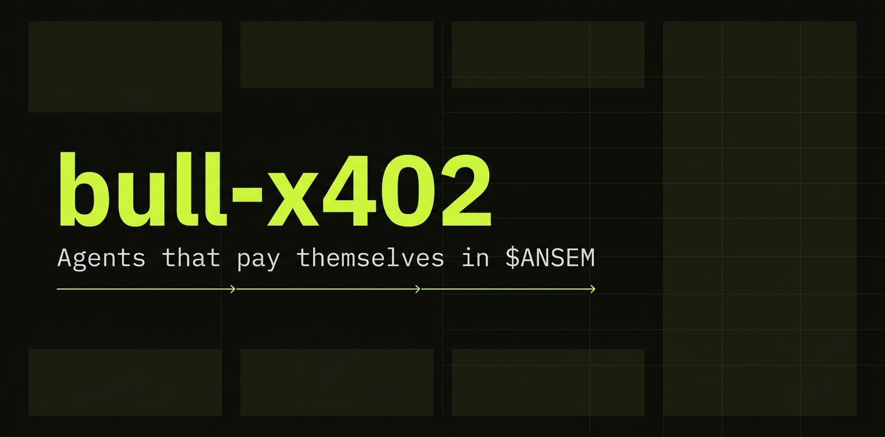
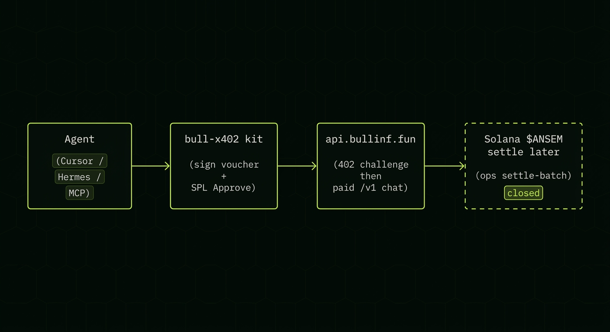

# bull-x402

<p align="center">
  
</p>

**Agents that pay themselves in `$ANSEM`.**

Open-source client kit for [Bull.inf](https://bullinf.fun)’s x402 `ansem-batch` rail: sign cumulative vouchers, SPL-Approve the treasury once, call OpenAI-shaped `/v1` endpoints with no `inf_` key.

## How it works

<p align="center">
  
</p>

```bash
npm i @bullinf/x402
# or
pip install bull-x402
```

```ts
import { keypairFromSeed, createPaidClient } from "@bullinf/x402";

const keypair = keypairFromSeed(Buffer.alloc(32, 0x11)); // use your own secret
const client = createPaidClient({ keypair });

const res = await client.chat.completions.create({
  model: "llama-3.1-8b-instant",
  messages: [{ role: "user", content: "gm" }],
});
console.log(res.choices[0].message.content);
```

Protocol details: [PROTOCOL.md](./PROTOCOL.md). Marketplace docs: [bullinf.fun/docs](https://bullinf.fun/docs).

## Packages

| Package | Language | Role |
|---------|----------|------|
| `@bullinf/x402` | TypeScript | SDK + optional MCP bin |
| `bull-x402` | Python | SDK |

Drop-ins: [Cursor](./dropins/cursor), [Hermes](./dropins/hermes), [MCP](./dropins/mcp).

## Security

- The agent keypair is a **hot wallet**. Approve only the `$ANSEM` you intend to spend.
- This kit **never** holds treasury keys and does **not** call settle-batch (Bull ops).
- Do not commit seeds or keypair JSON.

## License

MIT
